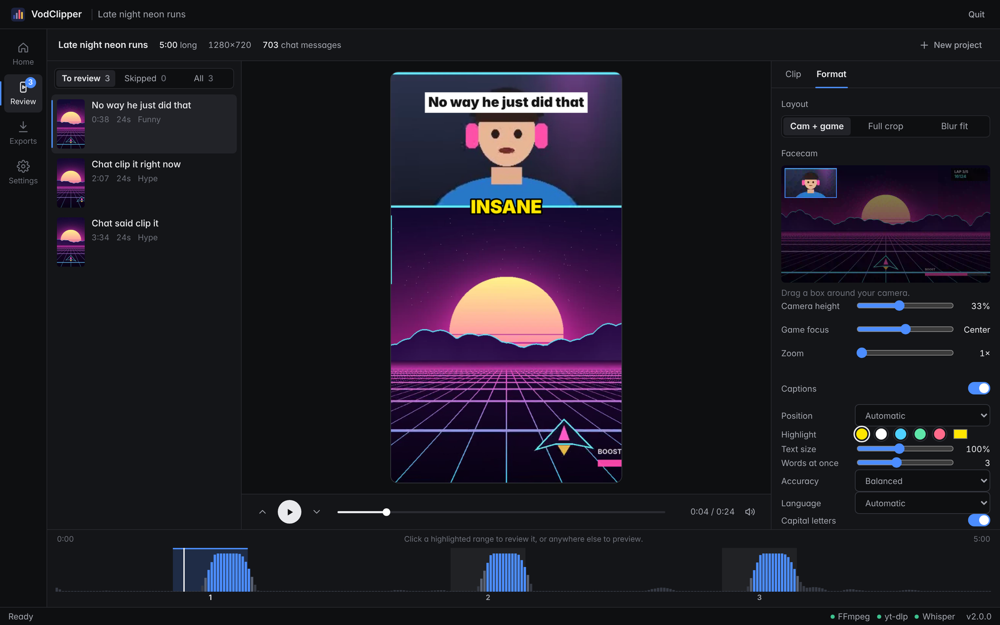

<p align="center">
  
</p>

<p align="center">
  <a href="https://github.com/ali1qbal/vodclipper/releases/latest"></a>
  <a href="https://github.com/ali1qbal/vodclipper/actions/workflows/build.yml"></a>
  
  <a href="CHANGELOG.md"></a>
</p>

<p align="center">
  <a href="https://github.com/ali1qbal/vodclipper/releases/latest/download/VodClipper-Setup.exe"><b>Download for Windows</b></a>
  &nbsp;·&nbsp;
  <a href="#features">Features</a>
  &nbsp;·&nbsp;
  <a href="#posting-to-tiktok">TikTok setup</a>
  &nbsp;·&nbsp;
  <a href="CHANGELOG.md">Changelog</a>
</p>

---

VodClipper watches a Twitch stream the way your chat does. It finds the moments where chat explodes and the audio spikes, cuts them into vertical 9:16 clips with captions and a title, and lets you review and post them to TikTok. It works on a past broadcast, or live while you're still streaming. Everything runs on your own PC.

<p align="center">
  
</p>

## Features

- **Finds the moments for you.** Clips are ranked by chat surges (KEKW, POG, "clip it", `?????`) and audio spikes measured against the surrounding minutes. Twitch's muted DMCA sections are ignored.
- **Live clipping.** Point it at a channel that's on air, and every strong moment shows up for review a few seconds after it happens. There's no limit on clips, and disk use stays flat.
- **Review in TikTok format.** Each suggestion plays in a phone-sized preview with its layout, title and word-by-word captions. Keep it with <kbd>Enter</kbd>, skip it with <kbd>X</kbd>, and move between clips with <kbd>↑</kbd> <kbd>↓</kbd>.
- **Auto titles and captions.** Whisper transcribes each clip. The title is the best line said near the peak, or one that fits the mood, and every clip gets a post caption with hashtags.
- **Three vertical layouts:** facecam above gameplay, full crop, or blurred fit. Choose the caption position, highlight colour, size and words per line.
- **Background render queue.** Clips render to 1080×1920 MP4 on your GPU's encoder (NVIDIA, Intel or AMD), falling back to the CPU automatically.
- **Post to TikTok** through TikTok's official Content Posting API, either directly or to your drafts. Nothing is ever posted without you clicking Post.
- **Tidy on disk.** Delete VODs and Delete all clips buttons are built in, and a real uninstaller is included.

## Screenshots

<table>
  <tr>
    <td width="50%"><p align="center"><sub><b>Live mode:</b> moments appear while the stream is still on air</sub></p></td>
    <td width="50%"><p align="center"><sub><b>Format:</b> layout, facecam crop and caption style</sub></p></td>
  </tr>
  <tr>
    <td width="50%"><p align="center"><sub><b>Exports:</b> rendered clips and the TikTok post form</sub></p></td>
    <td width="50%"><p align="center"><sub><b>Home:</b> start from a past broadcast or a live channel</sub></p></td>
  </tr>
</table>

## Install

1. Download **[VodClipper-Setup.exe](https://github.com/ali1qbal/vodclipper/releases/latest/download/VodClipper-Setup.exe)** and run it. It installs for your user only, so there's no admin prompt, and adds Start menu and desktop shortcuts.
2. The first time you open it, VodClipper offers to download FFmpeg, yt-dlp and TwitchDownloader for you.

Prefer not to install? Use [VodClipper-portable.zip](https://github.com/ali1qbal/vodclipper/releases/latest/download/VodClipper-portable.zip) instead. Unzip it anywhere and run `VodClipper.exe`.

> [!NOTE]
> The app isn't code-signed yet, so Windows SmartScreen may warn you the first time. Choose **More info › Run anyway**.

**Requirements:** Windows 10 or 11 (64-bit). An NVIDIA, Intel or AMD GPU speeds up rendering but isn't required. Captions download a Whisper model (a few hundred MB) the first time you use them.

## Usage

| | |
|---|---|
| **Past broadcast** | Paste a VOD link (`twitch.tv/videos/…`) or browse to a recording on your PC, then press **Find clips**. |
| **Live channel** | Enter a channel name or `twitch.tv/name` and press **Start live clipping**. The first minute or two is spent learning what "normal" sounds like for the stream. |
| **Review** | Keep (<kbd>Enter</kbd>) or skip (<kbd>X</kbd>) each suggestion. Trim it, edit the title (<kbd>T</kbd> cycles through ideas) and set the layout in the Format tab. During a live session, <kbd>C</kbd> clips the last 30 seconds. |
| **Exports** | Kept clips render here, named after their titles, with the post caption saved next to them as `.txt`. Select one to watch it or post it. |

Clips are saved to `Videos\VodClipper`. The full guide ships with the app as `README.txt`, and you can also read it in [docs/user-guide.txt](docs/user-guide.txt).

## Posting to TikTok

TikTok only lets registered apps post, so you set up your own free developer app once. **Settings › TikTok** walks you through it:

1. Create an app at [developers.tiktok.com](https://developers.tiktok.com/).
2. Add the **Login Kit** and **Content Posting API** products, and turn on **Direct Post**.
3. In Login Kit, choose the **Desktop** platform and add the redirect URI shown in Settings (`http://127.0.0.1:<port>/callback/`).
4. Paste the client key and secret into Settings and press **Save and connect**.

Until TikTok audits your developer app, direct posts can only be private ("Only me"). That's TikTok's rule for new apps. **Send to drafts** works either way. Your sign-in is stored encrypted with Windows DPAPI.

## Building from source

You need Windows and Python 3.10–3.13 (`install.bat` offers to install Python 3.12 with winget if it’s missing).

```bat
git clone https://github.com/ali1qbal/vodclipper
cd vodclipper
scripts\install.bat      &rem create a virtualenv and install dependencies
scripts\run.bat          &rem run from source (opens in your browser)
scripts\build_exe.bat    &rem build dist\VodClipper\VodClipper.exe with PyInstaller
```

The installer is built from `installer/vodclipper.iss` with [Inno Setup 6](https://jrsoftware.org/isinfo.php).

### Project layout

```
src/
  app.py          desktop window (pywebview / WebView2) and --selftest
  server.py       local HTTP API the UI talks to, render queue
  engine.py       download, analysis, clip picking, rendering, captions
  live.py         live recording, chat reader, moment detection
  tiktok.py       TikTok OAuth (PKCE) and Content Posting API client
  titles.py       auto titles and post captions
  tools_setup.py  downloads FFmpeg, yt-dlp and TwitchDownloader
  ui/             HTML/CSS/JS interface (Inter typeface, OFL)
scripts/          install, run and build scripts
installer/        Inno Setup script
tests/            end-to-end tests with a fake Twitch chat and mock TikTok API
docs/             user guide and images
```

### Tests

Every push builds the exe on Windows in GitHub Actions, then:

- runs the app's built-in self-test (`VodClipper.exe --selftest`): rendering, captions on real Whisper output and auto titles;
- runs `tests/e2e.py` against the built exe, with a simulated live stream served over HLS, a fake Twitch IRC chat and a mock of TikTok's OAuth and Content Posting API;
- installs and uninstalls the app with the real installer.

Run the end-to-end tests locally against the source:

```bash
python tests/e2e.py --app "python src/app.py" --ffmpeg ffmpeg
```

## Releases

Versions follow [Semantic Versioning](https://semver.org/), and changes are recorded in [CHANGELOG.md](CHANGELOG.md). To release, bump `src/version.py`, add a section for that version to the changelog, and push to `main`. CI builds and tests the app, then publishes `vX.Y.Z` with the installer, the portable zip and that version's notes.

---

<sub>VodClipper isn't affiliated with Twitch or TikTok. Only clip streams you own or have permission to repost.</sub>
