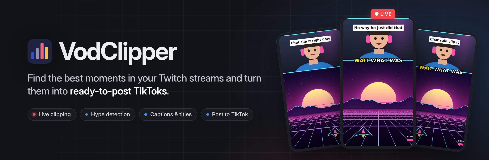
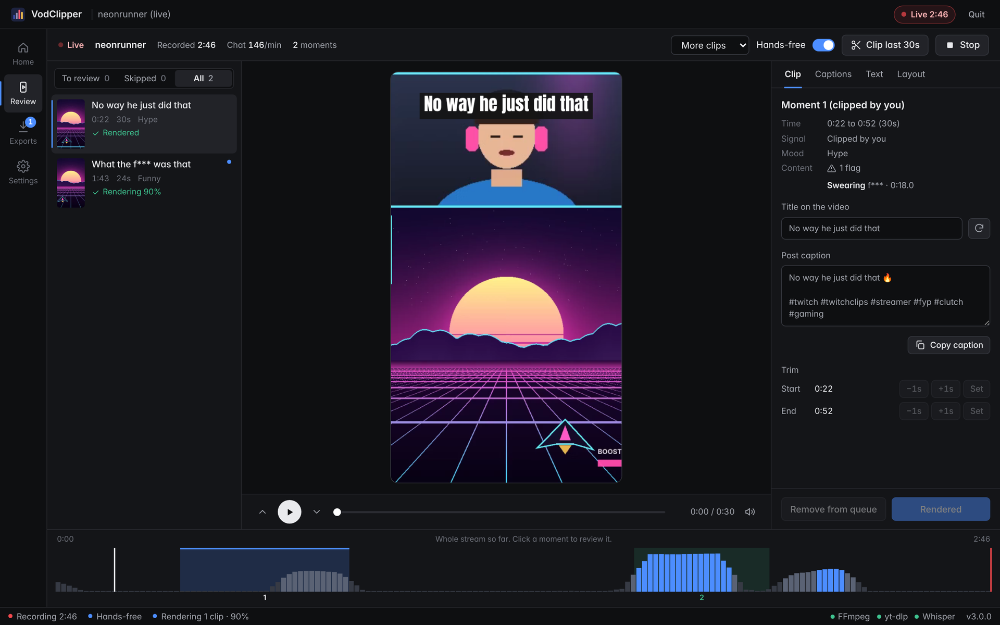
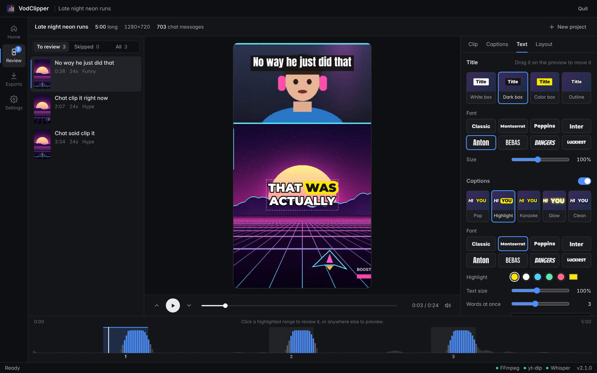
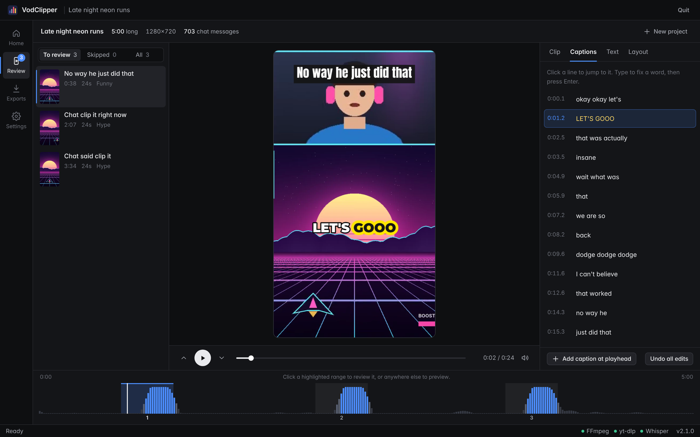

<p align="center">
  
</p>

<p align="center">
  <a href="https://github.com/allen1versonfr/vodclipper/releases/latest"></a>
  <a href="https://github.com/allen1versonfr/vodclipper/actions/workflows/build.yml"></a>
  
  
  <a href="CHANGELOG.md"></a>
</p>

<p align="center">
  <a href="https://github.com/allen1versonfr/vodclipper/releases/latest/download/VodClipper-Setup.exe"><b>Download for Windows</b></a>
  &nbsp;·&nbsp;
  <a href="#features">Features</a>
  &nbsp;·&nbsp;
  <a href="#posting-to-tiktok">TikTok setup</a>
  &nbsp;·&nbsp;
  <a href="CHANGELOG.md">Changelog</a>
</p>

---

VodClipper watches a Twitch stream the way your chat does. It finds the moments where chat explodes and the audio spikes, cuts them into vertical 9:16 clips with captions and a title, and lets you review and post them to TikTok. It works on a past broadcast, or live while you're still streaming. Everything runs on your own PC.

<p align="center">
  
</p>

## Features

- **Twitch, YouTube and X.** Open a Twitch VOD, a YouTube video, Short or finished livestream (with its chat replay), an X video, or a file on your PC. Clip Twitch and YouTube livestreams as they happen, several at once, and follow everything under Home › Running now.
- **Finds the moments for you.** Clips are ranked by chat surges (KEKW, POG, "clip it", `?????`), audio spikes measured against the surrounding minutes, and laughter, screams and cheering heard by a small built-in sound detector. Twitch's muted DMCA sections are ignored.
  - Chat is counted by chatters, not messages: bots, `!commands`, giveaways, sub notices, gift bombs, raids and copypasta don't create fake moments.
  - Each clip gets its own length (15–90 s): it starts with the setup, runs until the reaction dies down, and never cuts mid-sentence.
  - The review header estimates how many strong moments the stream has, and the number of suggestions scales with it.
  - **Deep scan** (optional) transcribes the whole stream and finds *quiet gems*: lines that landed even though chat and volume stayed calm.
  - It learns from the clips you keep, skip and post, separately for each streamer.
- **Hands-free live clipping.** Start it and go watch the stream. Every strong moment is titled, checked and rendered on its own, and finished clips land in Exports.
  - It can wait for the stream to start and keep watching for the next one.
  - Choose how many clips you want (Fewer, Normal, More or Lots).
  - Press <kbd>Ctrl</kbd>+<kbd>Alt</kbd>+<kbd>C</kbd> from any window to clip the last 30 seconds.
  - **No ads in your clips.** Ad breaks Twitch stitches into the stream are recognised and left out of the recording. Sign in to Twitch with Turbo (or a sub) and you get the ad-free stream.
- **Content check and censoring.** Each clip's words, title and post caption are checked for things TikTok takes down: slurs, self-harm, threats, personal info, sexual terms, drugs, swearing, gambling and your own blocked words.
  - Flagged words can be hidden in captions, muted or bleeped.
  - Hands-free holds risky clips back for you to look at first.
- **Review in TikTok format.** Each suggestion plays in a phone-sized preview with its layout, title and word-by-word captions. Keep it with <kbd>Enter</kbd>, skip it with <kbd>X</kbd>, and move between clips with <kbd>↑</kbd> <kbd>↓</kbd>.
- **Auto titles and captions.** Whisper transcribes each clip. The title is the best line said near the peak, or one that fits the mood, and every clip gets a post caption with hashtags.
- **Edit like CapCut.** Drag the title and captions anywhere on the frame, fix any caption line by typing over it, and add your own captions.
  - Five caption styles: Pop, Highlight, Karaoke, Glow and Clean.
  - Four title styles.
  - Eight bundled fonts, including Montserrat, Anton, Bebas Neue and Bangers.
- **Layouts and framing:** facecam above gameplay, the whole frame (following the streamer's face), the facecam alone, or a blurred fit. Auto-frame finds a facecam or a person and picks the layout.
- **Background render queue.** Clips render to 1080×1920 MP4 on your GPU's encoder (NVIDIA, Intel or AMD), falling back to the CPU automatically. If one fails, VodClipper says why in plain words and gives you a Retry button.
- **Post to TikTok** through TikTok's official Content Posting API, either directly or to your drafts. Hands-free mode can also send finished clips to your drafts automatically; you finish each post in the TikTok app.
- **Updates itself.** When a new release is posted on GitHub, VodClipper offers it in the app. One click downloads it, installs it and reopens the app.
- **Tidy on disk.** Delete VODs and Delete all clips buttons are built in, and a real uninstaller is included.

## Screenshots

<table>
  <tr>
    <td width="50%"><p align="center"><sub><b>Hands-free live:</b> clips render on their own while you watch</sub></p></td>
    <td width="50%"><p align="center"><sub><b>Home:</b> automatic clip count and length, Deep scan, ad-free live</sub></p></td>
  </tr>
  <tr>
    <td width="50%"><p align="center"><sub><b>Content check:</b> flag, hide, mute or bleep</sub></p></td>
    <td width="50%"><p align="center"><sub><b>Exports:</b> failures say why, with Retry</sub></p></td>
  </tr>
  <tr>
    <td width="50%"><p align="center"><sub><b>Text:</b> styles, fonts and drag-to-place text</sub></p></td>
    <td width="50%"><p align="center"><sub><b>Captions:</b> fix what was heard, line by line</sub></p></td>
  </tr>
</table>

## Install

1. Download **[VodClipper-Setup.exe](https://github.com/allen1versonfr/vodclipper/releases/latest/download/VodClipper-Setup.exe)** and run it. It installs for your user only, so there's no admin prompt, and adds Start menu and desktop shortcuts.
2. The first time you open it, VodClipper offers to download FFmpeg, yt-dlp and TwitchDownloader for you.
3. After that, VodClipper keeps itself up to date. New versions show up in the status bar and in **Settings › Updates**.

Prefer not to install? Use [VodClipper-portable.zip](https://github.com/allen1versonfr/vodclipper/releases/latest/download/VodClipper-portable.zip) instead. Unzip it anywhere and run `VodClipper.exe`.

> [!NOTE]
> The app isn't code-signed yet, so Windows SmartScreen may warn you the first time. Choose **More info › Run anyway**.

**Requirements:** Windows 10 or 11 (64-bit). An NVIDIA, Intel or AMD GPU speeds up rendering but isn't required. Captions download a Whisper model (a few hundred MB) the first time you use them.

## Usage

| | |
|---|---|
| **Past broadcast** | Paste a VOD link (`twitch.tv/videos/…`) or browse to a recording on your PC, then press **Find clips**. |
| **Live channel** | Enter a channel name or `twitch.tv/name`, pick **Hands-free** (clips render on their own) or **Review each clip**, choose how many clips you want, and press **Start live clipping**. It can start before the stream does. The first minute or two is spent learning what "normal" sounds like for the stream. |
| **Review** | Keep (<kbd>Enter</kbd>) or skip (<kbd>X</kbd>) each suggestion. Trim it and edit the title (<kbd>T</kbd> cycles through ideas). Fix captions in the **Captions** tab, pick styles and fonts in **Text**, and set the layout in **Layout**. Drag the title or captions on the preview to move them. During a live session, <kbd>C</kbd> clips the last 30 seconds. |
| **Exports** | Kept clips render here, named after their titles, with the post caption saved next to them as `.txt`. Select one to watch it or post it. |

Clips are saved to `Videos\VodClipper`. The full guide ships with the app as `README.txt`, and you can also read it in [docs/user-guide.txt](docs/user-guide.txt).

## Posting to TikTok

TikTok only lets registered apps post, so you set up your own free developer app once. **Settings › TikTok** walks you through it:

1. Create an app at [developers.tiktok.com](https://developers.tiktok.com/).
2. Add the **Login Kit** and **Content Posting API** products, and turn on **Direct Post**.
3. In Login Kit, choose the **Desktop** platform and add the redirect URI shown in Settings (`http://127.0.0.1:<port>/callback/`).
4. Paste the client key and secret into Settings and press **Save and connect**.

Until TikTok audits your developer app, direct posts can only be private ("Only me"). That's TikTok's rule for new apps. **Send to drafts** works either way. Your sign-in is stored encrypted with Windows DPAPI.

## Building from source

You need Windows and Python 3.10–3.13 (`install.bat` offers to install Python 3.12 with winget if it’s missing).

```bat
git clone https://github.com/allen1versonfr/vodclipper
cd vodclipper
scripts\install.bat      &rem create a virtualenv and install dependencies
scripts\run.bat          &rem run from source (opens in your browser)
scripts\build_exe.bat    &rem build dist\VodClipper\VodClipper.exe with PyInstaller
```

The installer is built from `installer/vodclipper.iss` with [Inno Setup 6](https://jrsoftware.org/isinfo.php).

### Project layout

```
src/
  app.py          desktop window (pywebview / WebView2) and --selftest
  server.py       local HTTP API the UI talks to, render queue
  engine.py       download, analysis, clip picking, rendering, captions
  live.py         live recording (own HLS reader that skips ads), chat reader, moment detection
  chatsignal.py   chat cleaning: chatters not messages, bots, notices, raids, copypasta
  audio_events.py laughter / scream / cheering detector (ONNX, built by scripts/export_audio_model.py)
  gems.py         Deep scan: scores every transcribed line, finds quiet gems
  learning.py     learns per streamer from what you keep, skip and post
  twitchauth.py   Twitch sign-in for ad-free live recording
  tiktok.py       TikTok OAuth (PKCE) and Content Posting API client
  titles.py       auto titles and post captions
  safety.py       content check (TOS scanner) and censoring
  hotkey.py       Ctrl+Alt+C clip hotkey on Windows
  updater.py      in-app updates from GitHub releases
  tools_setup.py  downloads FFmpeg, yt-dlp and TwitchDownloader
  ui/             HTML/CSS/JS interface, Inter and caption fonts (OFL / Apache)
scripts/          install, run and build scripts
installer/        Inno Setup script
tests/            unit tests, and end-to-end tests with a fake Twitch chat and mock TikTok and GitHub APIs
docs/             user guide and images
```

### Tests

Every push builds the exe on Windows in GitHub Actions, then:

- runs the unit tests: content check (`tests/test_safety.py`), and chat cleaning, Twitch ad markers, smart cuts, learning and the sound detector (`tests/test_signals.py`);
- runs the app's built-in self-test (`VodClipper.exe --selftest`): rendering, captions on real Whisper output, auto titles, styled text placement and bleeping;
- runs `tests/e2e.py` against the built exe: a VOD with a giveaway, a gift bomb, bots and a raid in its chat (the real moment has to win), Deep scan, learning from keeps and skips, hands-free live clipping from a pretend Twitch stream that starts late and has an ad break stitched in (no ad may be downloaded), a fake Twitch IRC chat with bots and sub notices, Twitch sign-in, the clip hotkey, the content check holding a clip back, a failed render being explained and retried, bleeping, automatic TikTok drafts against a mock of TikTok's API, and private-repository updates;
- installs the app with the real installer, updates it in place through the app's own updater (against a mock GitHub release), then uninstalls it.

Run the end-to-end tests locally against the source:

```bash
python tests/test_safety.py
python tests/test_signals.py
python tests/e2e.py --app "python src/app.py" --ffmpeg ffmpeg
```

## Releases

Versions follow [Semantic Versioning](https://semver.org/), and changes are recorded in [CHANGELOG.md](CHANGELOG.md). To release, bump `src/version.py`, add a section for that version to the changelog, and push to `main`. CI builds and tests the app, then publishes `vX.Y.Z` with the installer, the portable zip and that version's notes.

---

<sub>VodClipper isn't affiliated with Twitch or TikTok. Only clip streams you own or have permission to repost.</sub>
